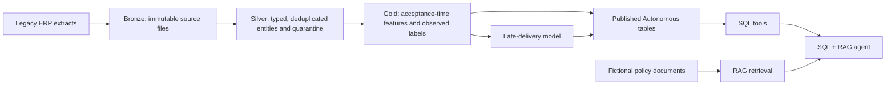

# Architecture and milestone boundaries

## 1. End-to-end flow

Source generation, validation, policy documents, initial Object Storage upload
and Autonomous account bootstrap are complete. Catalog/schema setup and raw
external Bronze registration are prepared as two importable AIDP notebooks;
the user has reported successful live Bronze counts and provenance checks.
Initial Silver quality logic and managed Delta publication are implemented and
tested locally, including real Spark/Delta fixture tests. The user reports
successful live Silver counts, empty quarantine and an identical insert-free
rerun; see [Silver evidence](aidp-silver-execution.md). Distributed initial Gold
is implemented in release 0.3.0; its live AIDP success is user-reported and the four counts were independently
corroborated. Model
training is implemented in release 0.4.0 with availability-aware temporal evaluation
and native MLflow integration; see [training](late-delivery-training.md). Inference,
Autonomous business tables/loading, retrieval indexing and agents remain future milestones. See [Gold setup](aidp-gold-setup.md),
[AIDP Bronze setup](aidp-bronze-setup.md) and [Silver setup](aidp-silver-setup.md).

## 2. Code organization

`src/aidp_lakehouse/` owns reusable logic: `generator.py`, `validation.py`,
`upload.py`, and the `cli.py` entry point. Future notebooks import these modules
and orchestrate examples; they must not become a second implementation of data
generation, cleaning, feature engineering or cloud access. Generator and checks
use the Python standard library. Only live upload needs the optional OCI SDK.

## 3. Data layers

The generator simulates versioned ERP exports, not already-cleaned lakehouse
tables. The shared AIDP bucket isolates demos under `demos/<demo-id>/`, and each
source-data version/run contains entity-specific initial/incremental prefixes.
Business ingestion reads only the entity prefixes; RAG reads only `documents/`.
Keep defect manifests and source metadata in the separate `_control/` prefix.
The implemented mapping is documented in [source-data.md](source-data.md).
Preserve original bytes, checksums, extraction cutoffs and manifests in Bronze. Actual
ingestion timestamp, object URI and ingestion run ID belong in separate Bronze
metadata; they are not synthetic business timestamps or model features.

Silver should parse UTC timestamps, quarantine invalid dates and unresolved
customer references, deduplicate exact repeats, and merge valid customer/order
versions by stable key with increasing `row_version` and `source_updated_at`.
Retain change history for point-in-time joins. An order's acceptance snapshot is
immutable even when its priority/status or its customer's segment changes later.
Initial and incremental batches are separately uploadable but incremental
validation/processing requires the initial state. Do not treat updates as new
orders or silently delete quarantined source rows.

Gold should expose operational facts and a separate model dataset with one row
per order at acceptance. Versioned source history allows checking exactly which
information existed at the prediction cutoff. Published Autonomous objects will
be owned by `LAKEHOUSE_DEMO`; grant `READ` only on explicitly approved objects to
`LAKEHOUSE_DEMO_RO`. Reuse the existing bootstrap and its connection alias
`CristinaVaras-ADBLakehouse-FY27`. This milestone executes no database operations.

## 4. Prediction contract

Prediction time is **order acceptance (`accepted_at`)**. The original promise,
quantity, line count, distance, customer segment/region, original priority,
inventory coverage, workload and planned carrier are stipulated to be known at
acceptance in this fictional scenario. The exact allowlist is in
`dataset_manifest.json` as `acceptance_features` and in the source-data contract.
In a real implementation, verify feature availability against source history.

Target: `delivered_at > promised_delivery_at_acceptance`. A delivery exactly at
the promise is on time. A completed delivery supplies a label only once it has
been observed by the training cutoff. Open orders have no outcome and must not
be labeled as on time. Future training needs explicit observation windows and
handling for right-censored orders; the clean historical cohort in these
extracts intentionally has fully observed outcomes.

Exclude current status/priority, order update timestamp/version, dispatch,
delivery, actual carrier and post-acceptance events from acceptance-time model
inputs. Customer/order/delivery/event IDs are join keys, not predictive features.
Customer master updates cannot replace historical acceptance snapshots. Use time
splits rather than random splits when evaluating the future model.

## 5. Outcome simulation

Historical deliveries use Bernoulli draws from a logistic probability influenced
by stock coverage, workload, quantity, distance, promise lead time, planned
carrier and original priority. An unobserved normal disruption term adds noise.
The probability and disruption are not exported. Conditional on the draw,
delivery occurs zero to two days early/on time or one to eight days late. Thus
the outcome follows the delivery timestamp consistently, while no acceptance
feature or fixed threshold deterministically specifies the target. Both outcomes
occur within each priority cohort in the verified 30,000-order dataset.

Open initial orders remain unlabeled until an incremental delivery arrives.
The incremental updates demonstrate that later outcomes and operational priority
can change without changing original acceptance features. This is a teaching
simulator with bounded cohorts, not a calibrated forecast of any real business.
